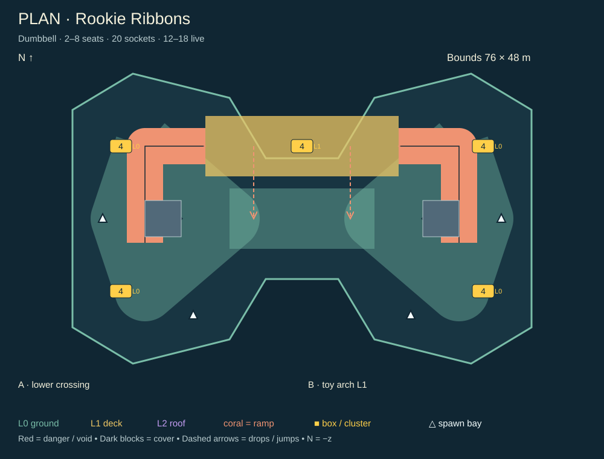

# Pocket Karts: launch arena plan

**Decision: build seven distinct battle maps. Change the playable ground, height routes, and live weapon supply together.** A painted road inside another square will not solve the feedback.

Planning only; audit captured 9 November, completed 10 November 2026. This work does not rebuild a map, change a game rule, push, or deploy. All new dimensions, counts, budgets, and timings below are **design targets**, pending greybox driving tests. A greybox is a playable map made from plain shapes before finished art.

[Contact sheet: all 25 sketches](../artifacts/kart-arena-plan/contact-sheet.png) · [Source audit numbers](kart-arena-plan/audit-data.json) · [Sketch generator](kart-arena-plan/build-sketches.mjs) · [Proposed route data](kart-arena-plan/plan-data.json).

## 1. Audit of the 11 current maps

### How to read the audit

These are SVG plans drawn from the **current numeric map definitions**, including the shared raised-layout, spawn, and feature passes. They are not screenshots or claims of playtest results. North is −z, metres are world units, and level heights are support heights. Small classic kickers are jumps, not a separate fighting floor. Raised SVGs show one slice per floor, keeping underpasses visible. Yellow dots show **all sockets**, not all live boxes. White triangles show authored starts; `1` and `2` mark the first two. `C` is a cannon; `P` is a portal. The audit uses the maps in this worktree, not an older memory or the previous document's performance figures.

A **socket** is a legal placed location. A **live box** is an available pickup in a match. Today they are very different numbers:

- Classic Zap Battle creates `clamp(4 + players, 6, 10)` boxes. On collection, a box immediately moves to another socket. There is no box respawn delay on this path.
- Four smaller raised maps create **6** boxes, regardless of 2–8 players. Skyport and Foundry create **9** for 2–8 players, **12** for 9–32. Collected boxes move to another socket on the same height layer and wait **2 seconds**. Thus the available count can temporarily fall below the created count.
- Raised maps guarantee a share per level: 3/3 in a two-level map; 3/3/3 or 4/4/4 in a three-level map. This is useful, but still sparse on their large ground floors.
- Current shared tier odds are **52% common / 43% uncommon / 5% rare**. Comments mentioning eight or sixteen weapons are stale: the current contract has **10**. Use the contract, not old prose.
- Classic maps, Skyport, and Foundry support 2–32 seats. The other four raised maps support 2–8. Raised maps currently require **Zap Battle, Garage off**, with 20 Hz JSON room updates; classic rooms have their separate adaptive realtime path. Do not assume a new raised map inherits classic modes or transport.

The table reports bounds area, **not usable surface area**. For raised maps, upper floors add space and cover removes space. Distances are straight-line centre distances in 3D, not road distance or proof of fairness. The minimum is across the maximum-size start pool. Frost Quarry's 0.12 m ice is grouped with ground.

| Current map / source plan | Bounds / area | Useful levels | Sockets by floor | Created boxes at 2 / 8 / 32 players | Starts and spread |
| --- | --- | --- | --- | --- | --- |
| [Rookie Ring](kart-arena-plan/audit-classic-ring.svg) | 60 × 60 m / 3,600 m² | 1; two 1 m kickers | 31 ground | 6 / 10 / 10 | 8 authored → 32 generated; first pair 30.5 m; minimum 4.6 m |
| [Bumper Blocks](kart-arena-plan/audit-classic-blocks.svg) | 60 × 60 / 3,600 | 1; one kicker | 25 ground | 6 / 10 / 10 | 8 → 32; first pair 38.6 m; minimum 4.6 m |
| [Garden Circuit](kart-arena-plan/audit-classic-garden.svg) | 120 × 120 / 14,400 | 1; three kickers | 38 ground | 6 / 10 / 10 | 10 → 32; first pair 38 m; minimum 4.6 m |
| [Frosty Pass](kart-arena-plan/audit-classic-frost.svg) | 120 × 120 / 14,400 | 1; two kickers | 39 ground | 6 / 10 / 10 | 10 → 32; first pair 50 m; minimum 4.6 m |
| [Neon Yard](kart-arena-plan/audit-classic-neon.svg) | 120 × 120 / 14,400 | 1; one kicker | 37 ground | 6 / 10 / 10 | 10 → 32; first pair 46 m; minimum 4.6 m |
| [Alpine Courtyard](kart-arena-plan/audit-raised-garden.svg) | 120 × 120 / 14,400 | 0, +7 m | 20 / 4 | 6 / 6 / unavailable | 8 authored, 6/2 by floor; first pair 121.6 m; minimum 19.4 m |
| [Frost Quarry](kart-arena-plan/audit-raised-frost.svg) | 120 × 120 / 14,400 | 0, +8 m | 18 / 7 | 6 / 6 / unavailable | 8, 6/2; first pair 128.7 m; minimum 31.1 m |
| [Neon Harbor](kart-arena-plan/audit-raised-neon.svg) | 120 × 120 / 14,400 | 0, +6 m | 20 / 4 | 6 / 6 / unavailable | 8, 6/2; first pair 127.3 m; minimum 20 m |
| [Harbor Heights](kart-arena-plan/audit-raised-harbor.svg) | 172 × 172 / 29,584 | 0, +7 m | 18 / 6 | 6 / 6 / unavailable | 8, 6/2; first pair 193.9 m; minimum 39.1 m |
| [Skyport](kart-arena-plan/audit-raised-skyport.svg) | 244 × 244 / 59,536 | 0, +10, +20 m | 16 / 15 / 15 | 9 / 9 / 12 | 32, 11/11/10; first pair 124.4 m; minimum 6 m |
| [Foundry](kart-arena-plan/audit-raised-foundry.svg) | 244 × 244 / 59,536 | 0, +10, +20 m | 16 / 14 / 15 | 9 / 9 / 12 | 32, 11/11/10; first pair 122.4 m; minimum 4 m |

### Play difference and verdict, map by map

**Rookie Ring:** The road draws two lobes with a contested centre, low inner barriers, grass escape space, two kickers, a cannon, a paired portal, and a side pit. Its legal ground and fence remain square; much of the road can be ignored. **Keep the simple two-lobe idea. Replace the square ground with a dumbbell and make its crossover a real over/under choice.** Thirty-two legal starts do not make this a good 32-player battle arena.

**Bumper Blocks:** Staggered tall bumper blocks make three lanes and a switchback, with side escapes, sand, a kicker, cannon, portal, and pit. It has more cover than Rookie, but shares its bounds, one fighting floor, and similar corner shortcuts. **Remove from the launch menu. Reuse its staggered cover and flanking rules in Neon Switchyard.** A maze is not enough reason for an eighth map.

**Garden Circuit:** Fountain cover, four garden rooms, a diamond promenade and outer loop improve local fights. Hedges break some shots. Grass and short jumps add small choices; two cannons and a portal cut travel. The 120 m square still has broad, flat spare land. **Merge with Alpine Courtyard into Garden Crown.** The fountain is a useful landmark; the whole map should inherit its structure.

**Frosty Pass:** The two low-grip lake halves change steering, while the grippy causeway invites straight fights and the shore horseshoes allow flanks. A separate cracked-ice fall patch, two cannons, and portal add risk and shortcuts. The bridge is a ground causeway, not an elevated crossing. **Merge with Frost Quarry.** Keep grip contrast; replace the square with a crescent and a real bridge over the lower ice.

**Neon Yard:** Six blocks around a market plaza create alley ambushes and medium street shots, with a kicker, two cannons, portal and goo patch. It has a better cover rhythm than the ring but remains one flat square city grid. **Merge its market and cover into Neon Switchyard.** Keep the offset streets and two colour landmarks, lose the unused corners.

**Alpine Courtyard:** A 28 × 24 m courtyard at +7 m has two ramps, an actual underpass, a fountain, hedge cover, upper screen, drop gaps, cannon ascent and cross-level portal. Six ground starts and two upper starts spread play, but the small eastern deck is an attachment to a much larger square plaza. **Good technical base, weak full-map silhouette. Merge with Garden Circuit.** Four upper sockets carrying three live boxes also leave little relocation choice.

**Frost Quarry:** Shelf at +8 m, 28 × 10 m bridge, east landing, three main climbs, a low kicker, solid ice, quarry shaft, cannon and portal offer the clearest two-level terrain play. **Keep its core mechanics. Rebuild as Frostbite Crescent.** The current square ground dilutes the shelf/ice relationship and wastes the chance for a strong shore shape.

**Neon Harbor:** A 28 × 28 m loading deck at +6 m, opposite climbs and underpass are close in structure to Alpine Courtyard. Cargo cover, water basin, screen, cannon and portal change dressing and some lines, but not the main decision pattern. **Retire as a separate map.** Reuse cargo art in Harbor Fork; keep the neon identity in Switchyard, with two connected elevated crossings instead of one deck.

**Harbor Heights:** Five +7 m decks form a cross-map upper band. Four main climbs and an optional kicker give genuine route choice; containers, warehouse, cannon, portal and open drop ends help. It has no authored fall-zone hole, though the world has harbor water scenery. **Keep the bridges and art, rebuild the playable ground as Harbor Fork.** Its present 29,584 m² square bounds, six boxes and eight-seat cap leave too much space for too few drivers.

**Skyport:** Two towers have +10 and +20 m decks, three bridge spans, an optional roof gap, a two-turn square helix, feeder decks, cover on each floor, drops, two cannons and a portal. It already offers layered interception, not just a road repaint. **Keep and focus it.** The 244 m square streets create long trips away from the towers; shrink to two joined districts, preserve the safe bridge bypass, and greatly increase loot. Its 61 map solids become 65 statics including shortcut frames.

**Foundry:** Ground service tunnels, +10 m docks, +20 m gantries, two-turn helix, three height-isolated conveyor zones, furnace, slag hole, crane yard, drops, two cannons and a portal form the richest current set piece. **Keep and simplify it into Foundry Wheel.** Shrink the outer yard, make the furnace the central orientation anchor, and give each floor a clear loop. The current 4 m closest start pair deserves a full hull/heading check; spacing alone neither proves overlap nor proves safety. Its 76 map solids become 80 with feature frames.

**Overall verdict:** the earlier pass did improve cover, traction and local routes. It did not change the shared square world shape or provide useful vertical combat to the classic five. The raised engine already solves much of the needed geometry. The largest design gains now come from smaller shaped ground, strong floor connections, better opening distances and much denser live loot.

## 2. Design pillars and launch rules

1. **Recognise a map from its legal ground outline.** Seven silhouettes: dumbbell, clover, crescent, long hexagon, trident, twin lobes and octagonal ring. The square `half` value may remain a broad bounds check; remove the full square floor underneath the intended outline. Out-of-shape space is either a clearly guarded edge or a visibly marked fall area. Road paint is guidance, never the sole definition of the map.
2. **Two or three useful floors.** Two floors for learning and medium maps, three for large maps. Aim for 25–45% of usable surface above ground; upper routes must carry boxes, cover and exits. No small balcony added only to claim verticality. Every main floor gets two ordinary driving connections; jumps, portals and cannons are optional shortcuts. Upper ownership must be flankable from two directions.
3. **A complete fight loop, then another way around.** Every combat district has two exits and reconnects in 8–15 seconds at ordinary driving speed. Avoid long single-file runs, maze cul-de-sacs and mandatory jumps. On three-floor maps, one climb per side and one central or rear connection create alternative circuits. A fall shortcut can intercept a pursuer, with a landing visible before commitment.
4. **One leading set piece per map.** Arch, fountain crown, quarry bridge, sign bridges, lookout, roof gap and furnace. Add at most two supporting hazards. Reusing cannons and portals is allowed, but they should solve long travel or vertical access; they should not appear in every corner of every map. Prefer one hazard taught clearly over several surprise penalties.
5. **Sightlines alternate with shelter.** Aim for 15–30 m common firing lanes, a few 35–50 m exposed lanes, and cover before either end of each long lane. No spawn faces a full-map shot. Use 1.4–2.5 m tall cover for real shot blocking; use short kerbs for edge guidance. Test at the actual weapon muzzle and projectile heights. Low rails are not automatically useful cover. Every camp position has two approaches and a marked drop escape.
6. **Read the next decision from the chase camera.** Show the next junction 12–20 m ahead. Ramp lips, safe rails, drop stripes and danger edges use distinct shapes, not colour alone. Each floor has a tint, a large symbol and a named landmark; each half has a different anchor. Keep scenery outside routes and prevent signs from hiding drivers. Validate on a phone in both light palettes.
7. **Wide enough to fight.** Target 12–16 m main routes, 10–12 m ordinary ramps, at least 10 m bridge driving width after rails, and 14–18 m turning landings. Small optional cuts may be 8 m for low-player maps. The current kart collision hull is 2.44 × 3.10 m; art is larger. Check swept turning clearance, not just whether a point fits. Start ramp grades around 1:4; use switchbacks or a helix when a direct 28–40 m run cannot fit. Sketch ramp lines show connectivity, not measured slope or exact footprints.
8. **Camera space is real space.** Start with ≥6 m clear underside height above the lower driving surface, 0.8 m deck thickness and rounded approach transitions. The normal camera is about 8.8 m behind and 3.2 m above, so height alone is insufficient. Reserve a clear camera volume through ramps, turns, low ceilings and drops; use the existing camera collision query and a tested close camera pose where needed. Do not rely on fading a deck to hide a bad camera path.

### Size and player count

Use **usable surface area A**, summed across floors after removing cover, voids and inaccessible margins. Count overlaps on different floors separately; count overlapping slabs on one floor once. These are starting bands, not a claim that all space is equally valuable.

| Active drivers | Target A | Opening / encounter target | Recommended rotation |
| --- | --- | --- | --- |
| 2–4 | 1,600–2,600 m² | First visible rival in 4–8 s without boost | Rookie duel core; full Rookie at 4 |
| 5–8 | 2,600–4,600 | Encounter in 3–7 s | Rookie; small Garden; small Frost/Neon from 6 |
| 9–16 | 4,600–8,500 | Encounter in 2–6 s | Full Garden/Frost; Neon; compact large maps |
| 17–24 | 8,500–12,000 | Encounter in 2–5 s | Full Neon/Harbor; medium Skyport/Foundry |
| 25–32 | 12,000–16,000 | Encounter in 2–5 s | Full Harbor/Skyport/Foundry |

Choose the variant before countdown. No shrinking floor during a match. A small variant closes named districts with visible solid gates and changes starts, boxes, routes and fall volumes together. Every enabled floor still has two normal connections. The host sees seat limits: a 32-person room cannot silently send 24 people to spectate on Rookie. Reuse the current `seatsFor`/preflight flow. No claim that all seven should fit 32 drivers.

### Starts and respawns for 2–32

- Author full, surface-tagged pools per variant. The white sketch triangles are **bays**, not final individual positions. Author twice the max seats as candidate poses for respawn variety; only the selected starting set must fit simultaneously. This requires separating start candidates from the current raised `spawns ≤32` active-pose contract.
- At two seats, start on the same floor in opposite lobes, about 25–40 m of drivable distance apart, without direct line of fire. At four, use four different sectors. Add sectors in a farthest-first order for 8/16/24/32; do not fill one row before opening another district.
- For 32 seats on large maps, begin with 16 ground / 8 middle / 8 upper. Spread eight sectors around the shape. No start directly under an upper start's attack edge. Adjust floor allocation after path-time checks; equal height counts are not required.
- Require ≥6 m centre spacing on the same floor as an initial target, plus full rotated-hull separation, wheel support and a clear 20 m departure lane. Keep starts ≥8 m from drops, pickup clusters, cannon/portal mouths and landing zones. Do not rely on Euclidean distance across stacked decks.
- Each start reaches two ordinary boxes in 2–4 s, with ≤1 s difference between competing starts. No rare-biased opening box. Maintain spawn protection; use the current combat value rather than creating a new map-specific damage rule.
- Respawn scoring considers same-floor enemies, reachable travel time, incoming fire, visible threats and recent spawn use, not just farthest 3D distance. Reject unsupported/occupied poses first. If all candidates are threatened, wait and retry safely; never insert a kart into another hull. Avoid repeating one bay. Measure deaths within 3 s of protection ending.

## 3. Weapon box economy

### Concrete count rule

**Double to quadruple the live supply in normal play.** Keep one weapon slot and current payload rules. More boxes should shorten unarmed driving, not let a loaded driver consume the whole route.

For each enabled variant, place `S` fixed sockets (roughly one per **150–220 m²** of usable surface, then adjust for route coverage). Create this many cycling box entities:

```text
B = min(S, 48, max(12, ceil(A / 320), ceil(1.25 × P) + 8))
```

`P` is the match's active roster at countdown, not spectator count. Freeze B for the round so disconnects cannot delete a box someone is approaching. A is a greybox target until measured. Table values below use this exact rule; intermediate player counts use the formula. Round by floor/district quotas while preserving the total. S includes reserve sockets that may be enabled by a larger variant; B is the count cycling in the chosen variant, **not a promise all are available at every moment**.

| Map / variant | Players used for examples | A target, m² | Enabled S | B created | Proposed B at max / current ancestor at same seats |
| --- | --- | --- | --- | --- | --- |
| Rookie duel | 2 | 1,800 | 16 | 12 | 12 vs 6 |
| Rookie full | 4 / 8 | 2,800 | 20 | 13 / 18 | 18 vs 10 |
| Garden small / full | 4 / 8 / 16 | 3,600 / 3,600 / 6,000 | 28 / 28 / 40 | 13 / 18 / 28 | 28 vs classic 10; raised had no 16-seat mode |
| Frost small / full | 6 / 8 / 16 | 4,200 / 4,200 / 6,300 | 32 / 32 / 44 | 16 / 18 / 28 | 28 vs classic 10 |
| Neon small / full | 6 / 8 / 16 / 24 | 4,200 / 4,200 / 7,800 / 9,600 | 32 / 32 / 48 / 48 | 16 / 18 / 28 / 38 | 38 vs classic 10 |
| Harbor compact / full | 8 / 16 / 24 / 32 | 7,200 / 8,400 / 11,000 / 13,000 | 40 / 48 / 64 / 64 | 23 / 28 / 38 / 48 | 48; old Harbor supported only 8 seats, with 6 |
| Skyport compact / full | 8 / 16 / 24 / 32 | 8,000 / 8,500 / 11,000 / 15,000 | 40 / 48 / 64 / 72 | 25 / 28 / 38 / 48 | 48 vs 12 |
| Foundry compact / full | 8 / 16 / 24 / 32 | 7,500 / 8,500 / 11,000 / 14,000 | 40 / 48 / 56 / 64 | 24 / 28 / 38 / 48 | 48 vs 12 |

Large-map eight-seat variants are optional advanced choices, larger than the preferred 5–8-player band. Do not put them in automatic eight-seat rotation until encounter times pass. Garden at four also needs a short-route test; Rookie remains the two-player default.

### Placement and cycling rules

- **Fixed homes:** after collection, a box disappears and returns at that socket. No immediate relocation to an unseen corner. The chosen home set is stable for a round. Select it with a seeded district/floor quota, not a whole-map random draw.
- **Route coverage:** every ordinary route branch has a box within 20–30 m; every floor has at least 4 cycling boxes. Small-variant quotas must still hold. Put 60–70% of homes on safe flow loops, 20–30% on exposed crossings/climbs, and at most 10% at jump or high-ground commitments. Never require a jump to get armed.
- **Spacing:** use 8–14 m between homes on a route; use staggered pairs 4–6 m apart at major junctions so one kart cannot sweep both at once. A yellow numbered block in a sketch is a **district total**, not a pile of overlapping boxes. Expand it into legal individual sockets during greyboxing.
- **Cover and clearance:** box centres need a 3 m clear driving approach, a full hull turning check and visible return-route space. Keep ordinary boxes ≥5 m from fall rims and ≥8 m from launcher/portal exits and expected landing envelopes. A risky landing box is placed after ≥10 m of safe run-out, not in the airborne arc. No box sits in a blind ramp lip or inside a cannon apron.
- **High ground:** include ordinary ammo along both ascents, not only at the defended top. Keep a rewarding exposed box near an overlook, but make it reachable from two sides. A rare-biased home must not also give the best cover and a one-way escape.
- **Respawn:** safe/common-profile homes return in **3 s**, exposed homes in **4 s**, rare-biased homes in **6 s**, measured on server simulation time. Show a quiet socket outline and the final 0.75 s re-form cue; do not add floating countdown text everywhere. If a kart is parked on the home, return visibly, but require it to leave a 3 m radius and re-enter before claiming again. Loaded karts cannot consume boxes. Validate this rule in both authorities.
- **Supply floor:** target at least 60% of B available during sustained combat. If below 50% for 3 s, log it; first shorten safe-home timers to 2.5 s in a tuning build. Do not add invisible emergency boxes. At B=48, three-second safe timers can support far more pickups than the old 12-box system, but actual consumption and route travel must be measured.
- **Fairness:** in the opening set, guarantee the two nearby safe boxes per start, then fill other district quotas. After countdown, use the same fixed homes. Server chooses rewards; clients only display them. Keep pickup claims and timers in snapshots/events, including reconnects.

### Rarity and power

Start with the current **52 / 43 / 5** common/uncommon/rare odds on ordinary homes. Common means Machine Gun, Tri-Shot and Mine. Uncommon means Missile, Cannon, Blades, Frost and Turbo Ram. Rare means Supernova and Nuke. Divide each tier's weight evenly between its current contract weapons, as today.

Use a distinct star-marked **risk box** on no more than 10% of homes, with **40 / 50 / 10** tier odds. Risk is a choice of position, not a guaranteed rare weapon. During the first 8 s, every home uses normal odds. Cap rare awards at **1 per 12 s for ≤8 players; 2 per 12 s for 9–16; 3 per 12 s for 17–32**, using a server-owned rolling window. When the cap is full, reroll into common/uncommon in their existing ratio. Thus ordinary odds are pre-cap odds, not a promise of a 5% realised rare rate. Retain item-slot and payload lifetime checks so repeat claims cannot stack powers. Measure Nuke warning visibility across decks and use the engine's real blast/occlusion rules; do not assume an upper floor is safe from an area weapon.

## 4. Final seven-map lineup

The ground outline, floor colours, box district totals and spawn bays are in each top view. Side views show heights and connections, not exact cross-sections or ramp lengths. A bridge may project over the ground outline. The route sketches are a design contract for the greybox, **not validated collider geometry**. Drawn box totals add to each map's full S; smaller variants enable a subset. Budgets and effort appear in sections 5–6.

### 1. Rookie Ribbons

**Theme:** a toy driving school. **Hook:** two broad lobes fight across a low road and an overhead toy arch.

[Top view](kart-arena-plan/plan-rookie-ribbons-top.svg) · [Side elevation](kart-arena-plan/plan-rookie-ribbons-side.svg)



- **Shape / scale:** 76 × 48 m dumbbell; ground and +6 m. Full A≈2,800 m². Duel variant closes the two far retreat pockets, preserving both lobes and both arch approaches; A≈1,800. Support 2–8; do not offer 16/32.
- **Routes / set piece:** lower waist crosses under the arch. Each lobe has an inner fight loop and a broad outer escape. Two opposite ramps climb the arch; two striped side drops return to lower approaches. No lethal hazard or forced jump. Use switchback ramp runs near 24 m for the 6 m rise, not the short lines in the sketch.
- **Boxes:** 20 homes: four in each of four ground turn districts, four on the arch. At 8 players B=18 with 14 ground / 4 arch. Duel B=12 with 8/4. One exposed arch home may have risk odds after the opening; safe boxes remain on both lobes.
- **Starts:** 16 candidate poses in four bays; simultaneous eight-seat selection starts 6 ground / 2 arch. Duel starts stay on ground, opposite lobes, with cover across the waist. Four seats use one bay each. Nobody starts facing the arch drop.
- **Reuse / new:** reuse Rookie's toy palette, low bumper pieces, grass, shared wedges/decks and drop stripes. New shaped floor slabs, arch silhouette/rails and safe duel gates. No cannon or portal; the arch itself teaches height choice.

### 2. Garden Crown

**Theme:** a four-wing garden with a fountain below a raised promenade. **Hook:** fight around the fountain, climb the crown, or cut under it to flank.

[Top view](kart-arena-plan/plan-garden-crown-top.svg) · [Side elevation](kart-arena-plan/plan-garden-crown-side.svg)

- **Shape / scale:** 100 × 96 m clover, ground / +7 m. A≈6,000 full; 3,600 small. Support 4–16. Small variant closes the outer tips of the north/south gardens while leaving the crown loop and both climbs open.
- **Routes / set pieces:** four ground rooms connect around a solid fountain. The raised crown is a loop with underpasses beneath its sides, two opposite 28 m climbs and two marked outward drops. Fountain jets are cosmetic; the stone alone blocks karts and shots. One cross-level portal can join a longer outer garden to the crown once normal climbs work.
- **Boxes:** 40 homes, 24 ground / 16 crown. Four ground districts ×6; four crown districts ×4. Full B=28 at 16 seats, quota 18/10. Small B=18 at eight, quota 12/6. Two exposed crown corner homes may use risk odds; none on the fountain or portal exit.
- **Starts:** 32 candidate poses in eight sectors. Sixteen-seat starting set 12/4 by floor; small eight-seat set 6/2. Four seats start in four ground gardens with equal fountain-route time. Hedges screen the first shot without trapping departure lanes.
- **Reuse / new:** Garden Circuit fountain/hedges/backdrop plus Alpine Courtyard's real underpass, ramps, golden level cues and portal. New clover slabs, connected crown segments, garden gates and a single oversized flower emblem. Remove repeated corner cannons.

### 3. Frostbite Crescent

**Theme:** a quarry cut around an icy inlet. **Hook:** the grippy upper shelf crosses above a slippery lower shoreline.

[Top view](kart-arena-plan/plan-frostbite-crescent-top.svg) · [Side elevation](kart-arena-plan/plan-frostbite-crescent-side.svg)

- **Shape / scale:** 104 × 88 m crescent; ground / +8 m; A≈6,300 full, 4,200 small. Support 6–16. Short variant gates far shore tips while keeping two upper climbs and the low ice bypass. The inset outside the solid crescent is water, not a hidden driving floor.
- **Routes / set pieces:** dry outer shore is the safe long loop; low-grip ice along the inner east bowl is the shorter exposed route. The shelf/bridge loops over this ice. Two ordinary 32 m ramp approaches reach it, with a third middle access if playtests show one end can be held. A small optional kicker crosses a shallow inlet notch to a wide grippy landing; a shore bypass always exists. One clearly striped shaft is the second hazard only if the inlet is already readable.
- **Boxes:** 44 homes: 26 ground/ice, 18 shelf. The central ice district has 6, four shore districts 5 each, three upper districts 6 each. Full B=28 quota 18/10; small eight-seat B=18 quota 12/6. Two risk homes sit after the jump run-out and on the exposed shelf, never on slippery approach lips.
- **Starts:** 32 candidate poses, eight shore/shelf bays. Sixteen-seat set 12 ground / 4 upper. Small eight-seat set 6/2. Starts are on grippy ground or shelf, never on ice or above the water rim; the ice remains a voluntary risk.
- **Reuse / new:** Frosty's grip contrast, Quarry's shelf/bridge/wedge collision, slate, crane, ice materials and scenery. New crescent shoreline slabs, wide landing, inlet signs and variant gates. Delay cannons/portals unless timing tests show a real travel problem.

### 4. Neon Switchyard

**Theme:** a night market under two bright sign bridges. **Hook:** weave through offset street cover, then climb above it for a fast exposed loop.

[Top view](kart-arena-plan/plan-neon-switchyard-top.svg) · [Side elevation](kart-arena-plan/plan-neon-switchyard-side.svg)

- **Shape / scale:** long 120 × 84 m hexagon; ground / +7 m. A≈9,600 at 24 seats, 7,800 at 16 and 4,200 small. Support 6–24. Small gates close outer service strips; keep both bridge approaches. The 16-seat version opens side streets before the full outer ends.
- **Routes / set pieces:** ground perimeter wraps offset market lanes. Two parallel sign bridges join via side decks into one upper loop. Two opposite switchback climbs need at least 28 m effective run each. Two marked drops intercept ground lanes. Six or fewer cover masses break shots; no thin maze. An optional ground conveyor is a readable 6 m/s travel assist, using Foundry's belt logic; it never spans a spawn or portal exit.
- **Boxes:** 48 homes split 24 ground / 24 upper, four districts of 6 on each. B=38 at 24 seats, quota 20/18; B=28 at 16, quota 16/12; B=18 at eight, quota 12/6. Up to four exposed bridge-centre homes use risk odds; ordinary boxes sit on both approaches.
- **Starts:** 48 candidate poses, eight bays. Twenty-four-seat set 16 ground / 8 upper; sixteen-seat set 12/4; small eight-seat set 6/2. Cyan market gate and pink sign tower mark opposite halves. One large arrow symbol per bridge avoids reliance on neon colour alone.
- **Reuse / new:** Neon Yard cover/market palette, Neon Harbor cargo and level markings, existing deck/kerb geometry, optional belt. New hexagon slabs, sign-bridge shells and simple market awnings contained inside collision cover. No moving traffic, trains or crusher required.

### 5. Harbor Fork

**Theme:** three dock fingers feeding a raised cargo yard and lookout. **Hook:** swap between separate dock lanes, a bridge loop and a high lookout.

[Top view](kart-arena-plan/plan-harbor-fork-top.svg) · [Side elevation](kart-arena-plan/plan-harbor-fork-side.svg)

- **Shape / scale:** 128 × 112 m trident; ground / +7 / +14 m. A≈13,000 full; compact 7,200, medium 8,400 or 11,000. Support 8–32. Compact gates shorten all three fingers and rear apron symmetrically; all three levels and both lookout approaches stay open.
- **Routes / set pieces:** ground fingers reconnect through the broad rear apron. The middle deck wraps two cross-dock spans with an underpass; the top lookout bridges the rear docks. Two lower climbs, two lookout climbs; each 7 m rise needs about 28 m run with wide turns. Open water between fingers is a real absence of ground. Rails guard ordinary driving edges; striped drop gaps return to visible dry aprons. One cannon from a long outer finger to a **middle** deck lane may shorten travel, avoiding instant high-ground ownership.
- **Boxes:** 64 homes: 32 ground, 20 middle, 12 lookout. Three forward districts and rear apron have 8 ground each; two side middle districts have 8 and rear link 4; lookout has 12 distributed along both approaches and span. B=48 at 32, quota 26/14/8; B=23 at eight, quota 13/6/4. Four risk homes near exposed span ends, after safe run-out.
- **Starts:** 64 candidates, eight bay sectors. Thirty-two-seat set 16/8/8; sixteen-seat 8/4/4; compact eight-seat 4/2/2. Alternate front fingers and rear sectors before filling middle positions. Do not place a start directly in a crane foot or cannon return lane.
- **Reuse / new:** Harbor Heights bridges, balconies, cargo, crane, warehouse, water art and kicker vocabulary. New forked ground slabs, lookout deck, clear edge barriers and ramps. Crane animation stays decorative. No moving bridge or boat physics.

### 6. Skyport Split

**Theme:** two connected car-park towers. **Hook:** chase across three floors, then choose the safe roof bridge or a visible gap shortcut.

[Top view](kart-arena-plan/plan-skyport-split-top.svg) · [Side elevation](kart-arena-plan/plan-skyport-split-side.svg)

- **Shape / scale:** 144 × 112 m twin-lobe outline with a street saddle; ground / +10 / +20 m. Full A≈15,000; compact/medium 8,000 / 8,500 / 11,000. Support 8–32. Close outer street pockets for compact play, retain both towers, both ascent systems and safe roof connection. This cuts the current 244 m square without flattening its strengths.
- **Routes / set pieces:** street loops under each tower meet at the saddle. Two middle bridges and one safe roof bridge connect floors. The other roof connection is a short gap with a broad landing and a lower catch shelf; ordinary driving remains available. West tower keeps a two-turn helix, tightened only if real steering tests allow it. East side uses an ordinary switchback system with roughly 40 m effective run per 10 m rise. Two cannons land in different upper districts; one portal joins a distant street and a middle lane.
- **Boxes:** 72 homes: 32 ground, 16 middle, 24 roof. Four street districts ×8; two parking districts ×8; three roof districts ×8. B=48 quota 22/12/14; compact eight-seat B=25 quota 13/6/6. Six risk homes maximum across roof gap run-out and exposed bridge shoulders, never in a landing envelope.
- **Starts:** 64 candidates, eight sectors; max set 16/8/8. Compact eight-seat set 4/2/2, both towers represented on each floor. Route time to the other tower matters more than straight distance. Helipad H, parking P, and street arrows remain huge orientation cues; give each tower a distinct roof silhouette.
- **Reuse / new:** current helix logic, towers, numbered pillars, parking materials, helipad, vans, bridges, shortcut features and warm/cool floor art. New shaped street slabs, compact ascent placement, catch shelf and gate states. No elevator needed.

### 7. Foundry Wheel

**Theme:** an octagonal industrial ring around a sealed furnace void. **Hook:** ride opposing conveyors below, flank through service loops, and drop from the gantry behind a rival.

[Top view](kart-arena-plan/plan-foundry-wheel-top.svg) · [Side elevation](kart-arena-plan/plan-foundry-wheel-side.svg)

- **Shape / scale:** 136 × 128 m octagonal ring, with a central non-driving furnace/slag opening; ground / +8 / +16 m. Full A≈14,000; compact/medium 7,500 / 8,500 / 11,000. Support 8–32. Compact gates shorten outer yard spokes, not the essential three rings.
- **Routes / set pieces:** each floor forms a complete loop. Two opposite service climbs between each tier need roughly 32 m effective run for each 8 m rise. Ground belts push opposite ways in separate side lanes; upper sorter crosses only its own floor. Two short service tunnels have end and side exits. The centre furnace glows behind a solid guard collar; deliberately marked outer maintenance drop gaps land on lower dry lanes. One optional slag opening may remain on an outer detour; do not turn every inner ring edge into a trap. One cannon skips the long climb, one portal joins separated ground/middle sectors.
- **Boxes:** 64 homes: 28 ground, 16 service, 20 gantry. Four ground sectors 8/8/6/6; two middle sectors ×8; two gantry sectors ×8 plus one exposed link district of 4. B=48 quota 24/12/12; compact eight-seat B=24 quota 12/6/6. Four risk homes on exposed gantry links, all outside furnace and drop margins.
- **Starts:** 64 candidates, eight sectors; max set 16/8/8; compact eight-seat set 4/2/2. Belt approaches have no starting positions. Furnace silhouette, west blue tank cage and east orange crane orient each floor. Cover must break ring shots without producing blind 90-degree exit traps.
- **Reuse / new:** furnace/tank/crane art, tunnels, belts, ramps, cover batches, feature runner and drop recovery from current Foundry. New octagonal floor/guard segments, tighter ring ramps and gate layouts. Do not add moving crushers, lava simulation or destructible supports for launch.

### What leaves the launch menu

| Existing maps | Result |
| --- | --- |
| Rookie Ring | Replaced by Rookie Ribbons |
| Bumper Blocks | Retired; cover patterns feed Neon |
| Garden Circuit + Alpine Courtyard | Merged into Garden Crown |
| Frosty Pass + Frost Quarry | Merged into Frostbite Crescent |
| Neon Yard + Neon Harbor | Merged into Neon Switchyard |
| Harbor Heights | Replaced by Harbor Fork |
| Skyport | Focused into Skyport Split |
| Foundry | Focused into Foundry Wheel |

Keep old map IDs usable for saved fixtures during migration; give new layouts new IDs/revisions. Retiring a menu entry does not mean silently giving its old ID a different collider world. Launch these seven for Zap Battle first. Classic Star Rush/Garage remain available on their old maps until the raised rules and art are deliberately supported; that compatibility set is separate from the seven-map Battle rotation.

## 5. Engine work and performance budgets

### What already exists, and where

| Capability | Current code / limits | Use in this plan |
| --- | --- | --- |
| Classic numeric roads, cover, grip, starts and sockets | [`kart-maps.js`](../apps/games/games/engines/kart-maps.js), [`kart-spawns.js`](../apps/games/games/engines/kart-spawns.js) | Reuse art/cover ideas; do not implement the seven as more flat roads |
| Shared raised map schema | [`kart-elevated-maps.mjs`](../apps/games/public/js/engines/kart-elevated-maps.mjs), [`kart-complex-maps.mjs`](../apps/games/public/js/engines/kart-complex-maps.mjs) | Finite decks, closed wedge ramps, height-tagged starts/sockets, two-turn helix, route labels, landmarks, drops |
| Layout / support / spawn passes | `kart-raised-{layouts,support,spawns}.mjs` in [`engines/`](../apps/games/public/js/engines/) | Reuse kerbs, floor splitting, shared wedge skin and support height, clear departure lanes |
| Authority geometry | [`kart-physics-core.mjs`](../apps/games/public/js/engines/kart-physics-core.mjs), [`kart-physics-config.mjs`](../apps/games/public/js/engines/kart-physics-config.mjs) | Already supports box, deck, convex wedge and bounded static triangle mesh; 128 statics, 32 karts, 60 Hz physics |
| Cannons / portals / falls | [`kart-map-features.mjs`](../apps/games/public/js/engines/kart-map-features.mjs), [`kart-raised-features.mjs`](../apps/games/public/js/engines/kart-raised-features.mjs), [`kart-feature-solids.mjs`](../apps/games/public/js/engines/kart-feature-solids.mjs) | Reuse scripted launch arcs, height-aware exits, cooldowns and hollow solid frames; account for their statics |
| Belts / height-aware pits | [`kart-elevated-surfaces.mjs`](../apps/games/public/js/engines/kart-elevated-surfaces.mjs) | Grounded wheel-surface check isolates conveyors; rectangular fall zones trigger only below their rim |
| Art | `kart-arena-{structure-art,features-art}.mjs`, `kart-raised-{readability,batches,shadows}.mjs`, [`kart-elevated-world.mjs`](../apps/games/public/js/engines/kart-elevated-world.mjs), [`kart-complex-world.mjs`](../apps/games/public/js/engines/kart-complex-world.mjs) | Instance repeated pieces; merge static details; existing stripes, level tints, landmark props, shadow proxy and quality levels |
| Camera | [`kart-raised-camera.mjs`](../apps/games/public/js/engines/kart-raised-camera.mjs) plus elevated view | Cached broad-phase bounds before exact mesh queries; retain finite deck undersides |
| Combat and rooms | [`kart-elevated-combat.js`](../apps/games/games/engines/kart-elevated-combat.js), [`kart-elevated-adapter.js`](../apps/games/games/engines/kart-elevated-adapter.js), [`pocket-karts/server.js`](../apps/games/games/pocket-karts/server.js) | Authority owns rewards, timer and selected variant; integrate seat/mode settings and snapshots |

### Required work, in dependency order

**P0 — Shared variant contract and shaped ground (3–4 engineer days).** Add stable `variantId`, enabled districts, level list, `playBounds`, usable-area metadata, active start set and separate respawn candidates. The server selects this before the match and supplies the same revision to prediction and art. Keep `half` as the enclosing broad bounds, not the playable outline. Build dumbbell/clover/fork shapes from contiguous boxes and rotated slabs. Build the octagon from a few simple floor pieces, with seams checked by hull driving. No new physical collider type is required for the proposed lineup. Do not put an invisible square floor under water or outside the shape.

The physics core accepts static triangle meshes, but the elevated visual adapter currently treats every non-wedge descriptor as a box with `half` dimensions. **Triangle-mesh physics support is not an end-to-end rendering contract.** If slab seams fail, an optional later mesh path must add matching render geometry, normals, camera proxy, grip support and bounded buffers. Prefer slabs for launch; do not quietly introduce arbitrary terrain meshes.

**P0 — Box system (3–4 engineer days).** Add cycling homes, per-district/floor quotas, 48-live/96-socket caps, timers, risk profile, rare-award window and leave/re-enter checks. The raised authority currently caps sockets at 64 and created crates at 12; `createRaisedPickups` defaults to capacity 32. Raise these specific limits with bounded arrays, snapshots and tests, and allocate one 48-instance pickup batch at loading. A 96-socket authoring cap allows reserve homes; do not render 96 live boxes. Reuse one texture/material; vary tint and star decal within the batch. Share the policy module with classic Battle if old maps also get the new economy. Do not change Star Rush collectibles by accident.

**P0 — Starts and compatibility (2–3 engineer days).** Replace label-only map assumptions with explicit map/variant capacities. Raise candidate-pool validation to a separate ≤64 record list, while preserving ≤32 selected active starts. Use authored floors, supported poses, hull casts, line-of-fire checks and travel-time scores. Gate raised Zap Battle/Garage restrictions clearly. New IDs must be accepted in room settings, adapter loading, preload and prediction identity; existing immutable world/projection and reconnect rules remain valid.

**P0 — Camera and route acceptance tools (3–4 engineer days).** Extend the existing clearance graph with directed links for jumps, drops, cannons and portals. A portal must not make a broken ordinary ramp network appear connected. Add chase-camera volume sweeps, underside rays from both sides, and replay capture. Share camera proxy transforms with authority solids and test them against the actual visible deck skin. Start with the existing broad-phase query; add a spatial index only if profiling shows a cost problem. This is tool work, not a new shipped bot opponent feature.

**P1 — Optional feature metadata / art generalisation (1–2 days).** Make fall rectangles and rails composable across shaped edges; add named safe landing volumes, home risk tags and district names. These are data/validation features, not new physics shapes. Refactor hard-coded map ID/environment branches in elevated/complex art so new IDs can reuse the correct toy/garden/frost/neon/harbor/foundry art. Decorative furnace glow, crane, fountain water and signs stay outside the authority. No moving decks, destructible geometry, crushers, elevators or dynamic trains are needed.

**P1 — Raised transport profiling (2–3 days reserved).** More boxes and full 32-player fights increase state and event traffic. First measure the existing 20 Hz JSON profile. If it misses the budget, port the established realtime codec with explicit vertical pose, crate-availability and feature-event support; do not claim classic binary transport already covers raised maps. Preserve prediction/epoch handling through warps, drops and reconnects. This can proceed after the first greybox, but a failed budget blocks 32-player acceptance.

### Per-map cost targets

These are **caps to build toward**, not new measurements. `World` means all map art, scenery, lights, rails, signs and static feature art in an unculled colour-pass census; it excludes karts, live pickups and transient combat. Triangles include all instances. Static colliders below include feature frames and enabled gate pieces; boxes, art and trigger metadata must not create extra dynamic bodies.

| Map | World draw calls ≤ | World triangles ≤ | Static allocation: floor / deck / wedge / cover / rails+frames+gates | Total static colliders ≤ | How it fits |
| --- | ---: | ---: | --- | ---: | --- |
| Rookie Ribbons | 45 | 28,000 | 10 / 5 / 4 / 8 / 17 | 44 | Shared toy material; one arch and two simple climbs; no shortcut frames |
| Garden Crown | 55 | 38,000 | 12 / 10 / 6 / 12 / 20 | 60 | Four garden modules; one fountain; hedge and crown pieces instanced |
| Frostbite Crescent | 58 | 40,000 | 12 / 8 / 6 / 12 / 24 | 62 | Repeated slate slabs; one bridge; one low-cost ice material; no translucent stacked water |
| Neon Switchyard | 60 | 38,000 | 10 / 10 / 6 / 12 / 22 | 60 | Six cover masses; sign atlas; emissive art instead of many real lights |
| Harbor Fork | 65 | 45,000 | 16 / 14 / 10 / 14 / 30 | 84 | Repeated cargo and bridge modules; static crane; one water plane outside ground |
| Skyport Split | 65 | 43,000 | 16 / 18 / 14 / 12 / 32 | 92 | Reuse batched helix/tower detail; two tower chunks; fewer distant props |
| Foundry Wheel | 68 | 46,000 | 16 / 18 / 12 / 16 / 34 | 96 | Merge pipes/tanks by material and sector; belts are surface math, not rigid bodies |

These allocations leave **32–84 statics of headroom** under the existing 128 limit for authoring changes; do not spend it automatically. Rails and floor seams usually consume more pieces than the first sketch suggests. Keep four metres or more of straight lead-in at joins and verify co-planar seams. If a map exceeds its allocation, simplify cover/rails first; keep one complete safe route per floor.

**Physics bodies:** each map adds **0 dynamic map bodies**. Rapier statics are standalone fixed colliders in the current core, not one rigid body per prop. At 32 drivers there are ≤32 dynamic kart bodies / chassis colliders, plus ≤96 statics on the largest design. Cannons temporarily disable a kart's existing body; they do not need another flight body. Pickups and belt/fall trigger checks are data queries. Keep existing projectile/mine/grenade pool limits; the box increase is not permission to uncap projectiles.

### Whole-game budgets and measurement rules

- Keep the existing raised audit fixture's **≤90 colour+shadow draws / ≤70,000 submitted triangles** for its prescribed detailed-kart/LOD setup. Keep the separate world-quality ceiling (currently 83 draws, 80,000 triangles and 12 MiB textures) too. The table's narrower map budgets do not replace either check.
- The actual production elevated view can keep more nearby drivers detailed than the audit helper. Therefore also budget a **real 32-player combat view**, including live boxes, weapons, effects, UI world meshes and shadows: high ≤240 draws / 180k submitted triangles; medium ≤170 / 120k; low ≤110 / 80k. These are proposed acceptance ceilings, not reported results. Report colour and shadow passes separately so tests cannot hide their cost.
- Keep map texture allocation ≤12 MiB on the existing accounting basis; reuse shared atlases, keep new repeated-detail textures ≤512², and do not add per-box textures. One sun and one ambient light; high 1024 shadow map, medium 512, low no shadow pass. No per-box shadow casters. The new 48 boxes add only **576 cube triangles** before any small shared decal geometry.
- Server target at 32: 60 Hz physics step p95 ≤6 ms, p99 ≤10 ms; full 50 ms room update work p95 ≤20 ms. Report physics and projection/serialization separately. Target client-bound traffic ≤100 KiB/s per seat during combat; test reconnect/keyframe spikes separately. This is a profile-and-fix target for raised JSON, not a confirmed capability.
- On a named target iPhone, after warmup: median ≥50 FPS, p95 frame time ≤25 ms at medium; low tier median ≥30 FPS, p95 ≤40 ms. Record device, OS/browser, thermal state, room size and resolution. Desktop target: 60 FPS at the agreed baseline resolution. Record p99 and ≥100 ms stalls as well as averages. A software renderer or a geometry census cannot prove these phone targets.
- Measure chase views with the worst overlook, busy tunnel, upper-deck fight and full box population. Re-run after adding all map art. Preserve the current loading warmup/disposal rules; changing maps repeatedly must not grow materials, textures, camera proxies or physics worlds.

For context only, [`kart-raised-performance.md`](../apps/games/docs/kart-raised-performance.md) reports past low-cost batched geometry censuses. [`kart-map-designs.md`](kart-map-designs.md) also records a 32-player software-rendered run at 4 FPS. These have different scenes/counting rules and are **not fresh benchmarks for this plan**. No gameplay or FPS improvement is claimed by these documents.

## 6. Phased build order, effort and verification

Estimates are focused person-days for one experienced engineer/designer, including ordinary review and iteration. They are not elapsed-day promises and assume existing art is reused. Keep each phase in a reviewable change; do not rebuild seven maps in one pass.

| Phase | Work / dependency | Effort | Exit gate |
| --- | --- | ---: | --- |
| 0. Agree the greybox contract | Lock seven hooks, size variants, box formula and camera/spawn rules from this plan; capture current reference matches | 1–2 days | Measured baseline and named target phone; no speculative art sprint |
| 1. Shared support | Variant/schema, box policy, starts, camera/nav tools, art ID reuse; reserve transport profiling work | 14–20 days | Synthetic two/three-floor fixture passes server, prediction, pickups, gate/reconnect and camera checks |
| 2. First playable slice | Rookie Ribbons (2–3 days) and Skyport Split (4–6): prove small learning map and 32-player height map before the rest | 6–9 days | 2/8 on Rookie, 8/16/32 on Skyport; full drive routes; box availability and camera acceptance |
| 3. Medium variety | Garden Crown 3–4, Frostbite Crescent 3–4, Neon Switchyard 3–4 | 9–12 days | Distinct grip, cover and upper-route choices; 4/6/8/16/24 as supported; no empty districts |
| 4. Advanced large maps | Harbor Fork 4–5, Foundry Wheel 4–6 | 8–11 days | Full 32 starts, safe water/furnace edges, belt height isolation, visible drops and alternate climbs |
| 5. Art, tuning and release candidate | All seven: art fit, phone/desktop passes, multi-match balance, compatibility and migration review | 7–10 days | All gates below pass; target-device results attached; separate launch approval |
| **Total** | Some art and tools can overlap after Phase 2; no implementation included here | **45–64 person-days** | No release date promised |

Phase 1 groups overlapping tool work; it is not the sum of every upper estimate in section 5. If raised transport needs a substantial port, allow a further **3–5 days** beyond its reserved profiling effort. If the first two maps miss steering or camera gates, revise ramp footprints and area targets before building the other five. Launch can stage three fully accepted maps for an internal playtest, but the final planned rotation remains seven.

### A. Source, geometry and route checks

For every variant, generate an audit from the **final loaded map**, after all layout/feature passes. Record revision, true A, bounds, level areas, collider count, legal socket count, selected starts and home quotas. No runtime test should accidentally import a sibling worktree's map source. Confirm dependency resolution before interpreting results.

Build a layer-aware clearance graph from real Rapier support/hull queries. Use ≤1 m sampling around ramps, lips, rails and narrow turns; coarser open-space sampling is allowed. Surface IDs distinguish overlapping roads. Every start must reach every ordinary box and every enabled floor **without using cannons, portals, drops or jumps**. Block one ordinary climb at a time: all floors must still be connected. Then test each directed shortcut separately, with its destination support and safe run-out checked.

Compute route distance and driving-time samples, not only point connectivity. Verify the two nearest ordinary homes per start, opening parity, box-free gaps, and all district exits. Reject unreachable decorative roofs from A. Verify every floor slice against a top-down render and the collider overlay, including the underside; a nice SVG is not this test.

### B. Bots must drive every floor

Extend the existing tests in `kart-complex-maps.mjs`, `kart-raised-quality.mjs`, `kart-raised-spawns.mjs` and `kart-raised-regressions.mjs`. Current checks already include connectivity, some continuous spiral driving, ramp replays and spawn departures; those do **not** prove an autonomous bot can navigate every new loop.

- For each variant, run a deterministic driver through **every ordinary directed route edge**, all floors, a complete clockwise and counterclockwise loop, and back to its start. Feed ordinary steer/throttle/brake input through the real server authority. No teleports or stuck recovery count as route completion.
- Run 20 seeds per variant with box-seeking bots for 3 minutes. Every enabled level and district must be visited by at least two bots where seat count permits; all cycling homes must be approached/collected across the batch. Log per-edge completion and failed turns. At two seats, use successive route runs rather than claiming two simultaneous bots cover every branch.
- Test ramp ascent/descent at low speed, ordinary speed, nitro, drift release, damaged/spun state and opposite traffic. Test gaps with a spread of approach speeds, off-centre takeoffs and a failed jump. Failure must reach a visible catch floor or the regular fall/respawn flow.
- Treat <0.5 m progress for 3 s under intended motion as stuck; capture pose, wheel contacts, route edge and replay. Acceptance: **zero repeatable geometry traps**, zero unsupported legal homes, zero route resets in the scripted traversal, and ≥99% successful edge runs across stress seeds. Review failures rather than hiding them with automatic recovery.
- Drive into every cover/rail corner at oblique angles, reverse away, park on every slope, land on deck edges, enter portals from both sides and occupy a cannon landing with a rival. Verify safe arrival rejection and retry behaviour. Tunnel exits must have real side clearance.

### C. Camera and visual acceptance

Use the production chase camera and visible kart art, with deck/cover collision proxies shown in a debug capture. Drive both ways over every ramp, under every bridge, around every turn and off every marked drop. Repeat on phone portrait and landscape, desktop wide view, day/night, and low/medium/high art tiers.

Sample normal and boosted motion plus abrupt steering near every underside. At each replay frame, test the camera eye and near-plane corners against solids; permit no visible world penetration. A rejected ideal camera position must resolve to a clear, stable close pose in that frame. Check the kart/driver bounding box remains inside the frame and the next route cue remains visible. Run rays from below and from inside a proxy envelope, not only from outside. **Gate: zero camera/deck crossings and zero reproducible view traps in these replays.** If needed, widen or raise the map opening before adding camera special cases.

Save top-down slices, side collider overlays, and ordinary chase images for every floor in both light palettes. Add video of the hardest ramp/underpass/drop per map. Check silhouettes without road paint, confusing identical corners, hidden rival silhouettes, HUD coverage and danger-edge contrast. Review the assembled populated map, not isolated prop renders.

### D. Box, combat and spawn acceptance

At 2/4/8/16/24/32 where supported, verify B from the formula, enabled S, floor quotas and fixed homes over 20 seeds. Exercise full weapon slots, simultaneous claims, cooldown boundaries, parked drivers, KO, disconnect/reconnect, late spectators and map changes. Claims award once on the server; prediction never creates an item or coin. Rare rolling-window tests use simulated time and test the first-eight-second rule.

Target: median unarmed travel to a reachable available ordinary box ≤4 s, p95 ≤8 s; ≥60% homes available in sustained play; no floor without an available ordinary box for >3 s. Record supply shortfalls by district. At 32, use active firing bots and actual payload retirement; idle karts do not test the new economy. Check increased traps do not permanently seal both exits of a district.

Cast and physically drive every selected initial pose with full visible art. Test all 32 departures simultaneously. Require no overlaps, no forced immediate falls, no geometry hits in the intended 20 m opening lane, and the two box timing targets from section 2. Run at least 10 full three-minute matches at minimum, middle and maximum supported seat counts, rotating spawn sectors. Flag any sector with >15% excess deaths in the 3 s after protection ends or >20% pickup-rate difference after controlling for time alive. These are review triggers; limited bot samples cannot prove human balance. Follow with at least two human sessions per map (new and experienced drivers) before final tuning.

Shoot through and across every height connection. Check muzzle obstruction, finite deck undersides, missiles, mines on slopes, area effects across floors and cannon/portal pose epochs. Preserve the current 100 HP weapon damage, one-slot rules and safe recovery. Do not change combat damage to rescue a weak map layout.

### E. Performance and regression acceptance

Run existing map/elevation/physics/camera/transport suites first, then the new variant and economy checks. Use `npm run test:kart-elevation`, `npm run test:kart-camera`, `npm run test:kart-road`, `npm run test:kart-payloads`, realtime tests, and the 32-player room/browser path extended to raised maps. After all maps are integrated, run full `npm test`; report existing baseline failures separately with reproduction evidence, not as silent waivers.

Attach unculled geometry censuses and actual renderer counters for worst views. Profile client frame times, GPU load where available, server step times, projection cost and bandwidth for 5 minutes per tier/map after warmup. Include a 32-player combat run and ten consecutive rematches/map swaps to catch pool leaks and warmup stalls. Meet section 5's phone and server gates on named hardware. Do not accept only bots, only unit tests, or only screenshots as full readiness.

### Status of this planning delivery

Verification completed: all 25 SVGs parse, local document links resolve, seven box-cluster totals match their floor allocations, and the box-count table matches the stated formula. Fourteen current raised-authority initialization cases passed at 2/8 seats on all six maps and at 32 on both complexes; [recorded results](kart-arena-plan/verification.json). The contact sheet was rendered and visually reviewed. No full gameplay suite was needed for this docs-only change.

Completed here: source audit of 11 maps; 11 floor-sliced SVG audit plans; 7 proposed top views and 7 side sketches; source-derived counts and layout data; a single rendered 25-sketch contact sheet. The generator reads game definitions and writes only these planning assets. No new map collider, live box rule, bot navigation or camera path has been implemented or playtested by this task.

Rebuild drawings from the worktree root with Node 24:

```sh
node docs/kart-arena-plan/build-sketches.mjs
# Requires an available Playwright package and installed Chromium:
KART_PLAN_PLAYWRIGHT=/absolute/path/to/playwright/index.mjs node docs/kart-arena-plan/build-sketches.mjs --render
```

`--render` creates `artifacts/kart-arena-plan/contact-sheet.png`. The environment variable selects the tool package only; all imported map code comes from this worktree. The PNG is explicitly tracked despite the repository's broad artifacts ignore rule. All SVGs are self-contained and have text labels and an accessible image title. Individual SVGs preserve detail when the full sheet is zoomed out.
